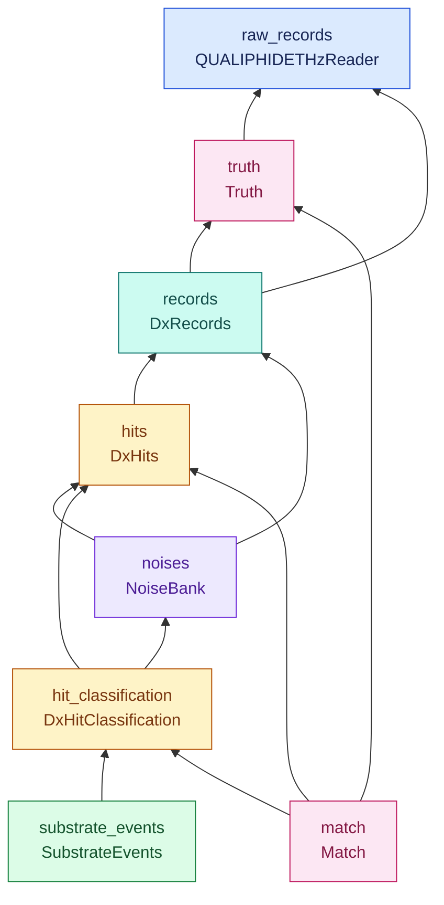
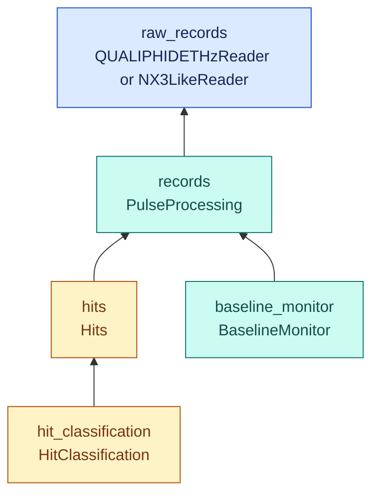

# Data structure

Arrows point from a product to its direct dependencies: `A --> B` means
“A depends on B.” Node colors indicate data kinds. Products with different data
kinds require separate `get_df` (or `get_array`) calls.

## Offline processing

The `qualiphide_thz_offline` context uses the following dependency graph.
`DxHitClassification` consumes `hits` and `noises`; optimal-filter fitting and
noise PSD estimation remain in that plugin. `SubstrateEvents` consumes only
`hit_classification`.

Moving-average peak coincidence and native peak/support metadata are produced
with `hits` and carried into `hit_classification`. The optional legacy
record-threshold coincidence is computed upstream in `DxHits`. See the
[peak timing contract](../../docs/PEAK_CONTRACT.md) for selection defaults,
legacy comparisons and cache migration.

## Online and test processing

`qualiphide_thz_online` uses the theta pipeline below. The `qualiphide` test
context has the same dependencies, with `NX3LikeReader` providing `raw_records`.

## Data kinds

| Data kind | Products | Color |
| --- | --- | --- |
| `raw_records` | `raw_records` | Blue |
| `records` | `records`, `baseline_monitor` | Teal |
| `hits` | `hits`, `hit_classification` | Amber |
| `noises` | `noises` | Purple |
| `truth` | `truth`, `match` | Pink |
| `substrate_events` | `substrate_events` | Green |
